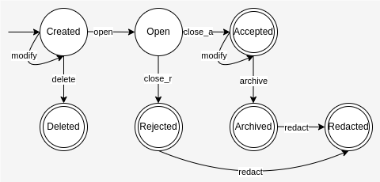

# Diiudicatio (Abstimmungstool)

## Abstimmungsarten

- [ ] relative Mehrheit
- [ ] einfache Mehrheit
- [ ] einfache qualifizierte Mehrheit
- [ ] absolute qualifizierte Mehrheit
- [ ] integrierte Stichwahl
- [ ] Zustimmungswahl
- [ ] geheime Abstimmung
- [ ] namentliche Abstimmung

## Abstimmungen

- Erstellt (Created)  
Abstimmung ist erstellt, aber noch nicht offen zur Abstimmung
- Geöffnet (Open)  
Ist offen zur Abstimmung. Ab diesem Punkt werden alle Änderungen am Abstimmungstext aufgezeichnet und die Abstimmung kann nicht mehr gelöscht werden.  
- Gelöscht (Deleted)  
Abstimmung wurde erstellt, aber nicht geöffnet und kann restlos gelöscht werden.
- Abgelehnt (Rejected)  
Abstimmung wurde als *Abgelehnt* archiviert.
- Angenommen (Accepted)  
Abstimmung wurde angenommen.
- Archiviert (Archived)  
Angenommene Abstimmung wurde archiviert und ist nicht mehr gültig.
- Geschwätzt (Redacted)  
Abstimmungstext einer archivierten Abstimmung wurde geschwärzt. (Bspw. um persönliche Daten zu schützen.) 

$$
\begin{align*}
\text{States} &=\{\text{Created}, \text{Open}, \text{Accepted}, \text{Rejected}, \text{Archived}, \text{Redacted}, \text{Deleted}\} \\
\text{Initial States} &= \{\text{Created}\} \\
\text{Accepted States} &= \{\text{Accepted}, \text{Rejected}, \text{Archived}, \text{Redacted}, \text{Deleted}\} \\
\text{Alphabet} &= \{modify, open, close_{accept}, close_{reject}, archive, delete, redact\} \\
\text{Transitions} &= \lbrace \\
    & \qquad (\text{Created}, modify, \text{Created}) \\
    & \qquad (\text{Created}, delete, \text{Deleted}) \\
    & \qquad (\text{Created}, open, \text{Open}) \\
    & \qquad (\text{Open}, close_{accept}, \text{Accepted}) \\
    & \qquad (\text{Accepted}, modify, \text{Accepted}) \\
    & \qquad (\text{Accepted}, archive, \text{Archived}) \\
    & \qquad (\text{Archived}, redact, \text{Redacted}) \\
    & \qquad (\text{Open}, close_{reject}, \text{Rejected}) \\
    & \qquad (\text{Rejected}, redact, \text{Redacted}) \\
&\quad \rbrace \\
\end{align*}
$$

## LICENCE
Copyright (c) 2024 Jonathan "Nath" Schild. Licensed under the EUPL-1.2
